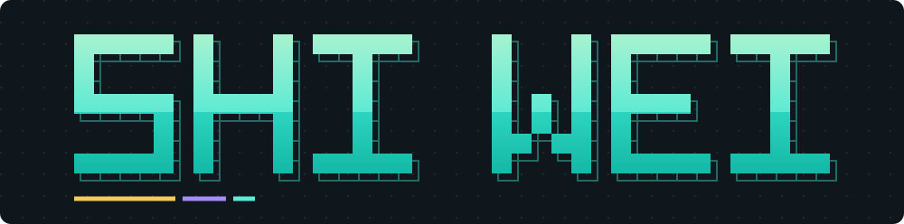

  

  
  
  

<picture>
  <source media="(max-width: 480px) and (prefers-color-scheme: dark)" srcset="https://readme-typing-svg.demolab.com?font=monospace&amp;center=true&amp;size=16&amp;duration=3200&amp;pause=1600&amp;color=70B8AE&amp;width=400&amp;height=76&amp;multiline=true&amp;groups=2,1,2&amp;lines=There%E2%80%99s+too+much+left;to+discover.;Building%2C+learning%2C+asking+questions.;Exploring+how+AI+can;expand+human+capability.">
  <source media="(max-width: 480px)" srcset="https://readme-typing-svg.demolab.com?font=monospace&amp;center=true&amp;size=16&amp;duration=3200&amp;pause=1600&amp;color=26766F&amp;width=400&amp;height=76&amp;multiline=true&amp;groups=2,1,2&amp;lines=There%E2%80%99s+too+much+left;to+discover.;Building%2C+learning%2C+asking+questions.;Exploring+how+AI+can;expand+human+capability.">
  <source media="(prefers-color-scheme: dark)" srcset="https://readme-typing-svg.demolab.com?font=monospace&amp;center=true&amp;size=18&amp;duration=4200&amp;pause=1600&amp;color=70B8AE&amp;width=660&amp;height=40&amp;lines=There%E2%80%99s+too+much+left+to+discover.;Building%2C+learning%2C+asking+questions.;Exploring+how+AI+can+expand+human+capability.">
  
</picture>

CS student based in Malaysia. Got distracted by agentic AI somewhere along the way and haven't really recovered.

I build applications and systems with LLMs, with a particular interest in agents, context, and memory. Alongside that, I'm learning how intelligence works—from machine learning and neural networks to the questions that draw me toward neuroscience.

## Questions that keep me curious

- **Agents and memory:** How can systems retain useful context and act reliably across multiple steps?
- **AI/ML and computer science:** How does intelligence emerge, and how can we build systems that expand human capability?
- **Neuroscience and mental health:** How can AI help us understand cognition, augment it, and address mental health disorders?
- **AI for Science and longevity:** How can we gain more time for scientific discovery, learning, and understanding the world?

There's too much left to discover in one lifetime. That's a big part of what draws me to longevity.

## Currently learning

Building my foundations in **machine learning, deep learning, and neural networks** alongside the systems I ship.

## Tools I work with

  

  
  &nbsp;
  
  &nbsp;
  

## Selected builds

- **[Lostopedia](https://github.com/S-W-Leong/lostopedia)** — Lost-and-found platform. **2,000+ registered accounts · 90+ items recovered · zero infrastructure cost.** [Live ↗](https://lostopedia.com)
- **[E-Com67](https://github.com/S-W-Leong/E-Com67)** — AWS e-commerce with AI agents; architected end to end.
- **[Complaint classification](https://github.com/S-W-Leong/complaint-classification)** — Classical ML vs. DistilBERT for complaint urgency.

## Let's connect

Open to **research collaborations and engineering opportunities** involving AI/ML and useful real-world systems.

  
  

---

A little tree growing alongside my work. Made with <a href="https://github.com/egorthinks/git-bonsai">Git Bonsai</a>.

